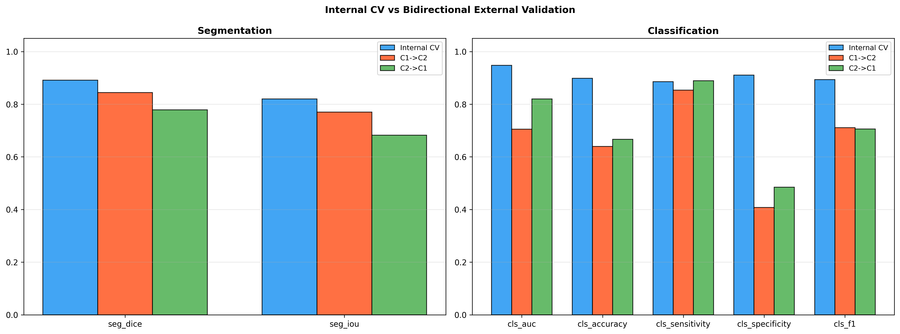
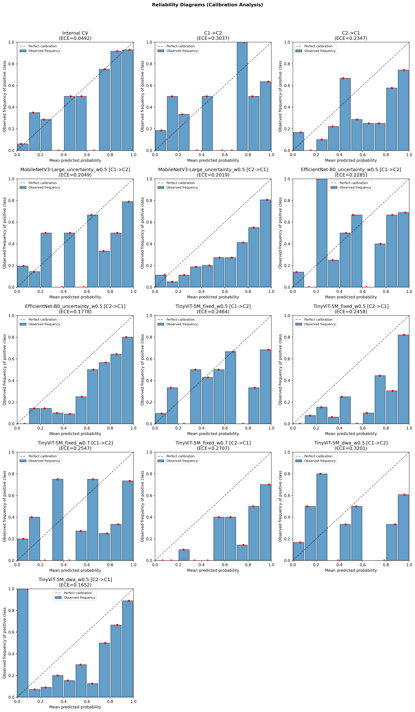
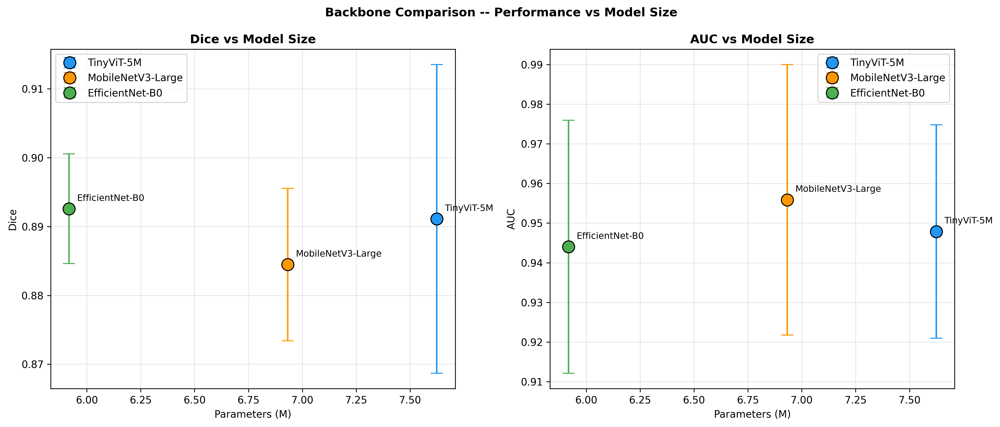
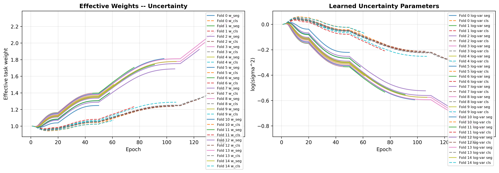
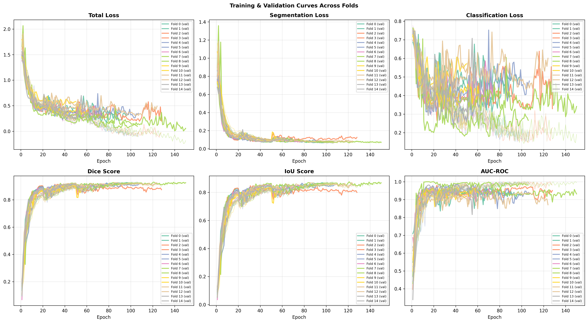

# MTL-LymphNet

[](https://www.python.org/downloads/)
[](LICENSE)
[](tests/)
[](https://journals.sagepub.com/home/uix)

Official PyTorch implementation of **MTL-LymphNet**: a lightweight, modular multi-task learning framework for simultaneous cervical lymph node segmentation and metastasis classification in thyroid cancer ultrasound.

> **Article Reference:**  
> Muhammad Thahiruddin, Imam Wahyudi, and Alfie Nuril Musthofa, *"MTL-LymphNet: A Lightweight Multi-Task Learning Framework for Simultaneous Lymph Node Segmentation and Metastasis Classification in Thyroid Cancer Ultrasound"*, **Ultrasonic Imaging**, SAGE Publications, 2026.

---

## Key Highlights

- **Simultaneous Multi-Task Learning**: Jointly solves boundary segmentation and metastatic status classification using a shared lightweight encoder (`TinyViT-5M`, 7.62M parameters).
- **Leakage-Safe Evaluation Protocol**: Implements strict nested train/val/test splits enforced at the API level (`mtl_lymphnet.data.splits`), guaranteeing zero test-set leakage during early stopping and model selection.
- **Uncertainty Loss Weighting**: Employs homoscedastic uncertainty loss balancing to dynamically weigh segmentation (Dice + BCE) and classification objectives without manual hyperparameter tuning.
- **Thorough Validation**: Evaluated on 338 ultrasound examinations across two independent clinical centers, featuring multi-seed internal 5-fold cross-validation ($N=15$), bidirectional external validation, DeLong tests, Benjamini-Hochberg FDR adjustments, bootstrap confidence intervals, and reliability calibration (ECE/MCE).
- **Clinical Edge-Deployment Ready**: Compact footprint (29.1 MB weights) with CPU inference time of ~131–134 ms, enabling point-of-care ultrasound CAD deployment.

---

## Core Experimental Results

### 1. Internal 5-Fold Cross-Validation (Multi-Seed Stability)
Performance of the proposed MTL-LymphNet across three independent random seeds (42, 43, 44) and pooled evaluation ($N=15$ total test folds) on Center 1:

| Seed | Folds ($N$) | Dice (%) | IoU (%) | HD95 (mm) | AUC | Accuracy (%) | Sensitivity (%) | Specificity (%) | F1-Score (%) | MCC |
|:---:|:---:|:---:|:---:|:---:|:---:|:---:|:---:|:---:|:---:|:---:|
| 42 | 5 | $89.71 \pm 2.52$ | $82.60 \pm 3.48$ | $15.79 \pm 3.93$ | $0.9431 \pm 0.0347$ | $89.92 \pm 2.95$ | $88.33 \pm 1.30$ | $91.43 \pm 5.11$ | $89.47 \pm 2.88$ | $0.7994 \pm 0.0591$ |
| 43 | 5 | $89.46 \pm 1.11$ | $82.61 \pm 1.72$ | $15.78 \pm 2.79$ | $0.9468 \pm 0.0297$ | $90.84 \pm 3.50$ | $90.25 \pm 5.16$ | $91.43 \pm 5.11$ | $90.49 \pm 3.58$ | $0.8190 \pm 0.0695$ |
| 44 | 5 | $88.16 \pm 2.47$ | $80.82 \pm 3.29$ | $16.44 \pm 3.49$ | $0.9537 \pm 0.0056$ | $88.74 \pm 3.63$ | $87.06 \pm 8.05$ | $90.29 \pm 6.15$ | $88.05 \pm 4.39$ | $0.7799 \pm 0.0710$ |
| **Pooled** | **15** | **$89.11 \pm 2.24$** | **$82.01 \pm 3.06$** | **$16.00 \pm 3.45$** | **$0.9479 \pm 0.0269$** | **$89.83 \pm 3.48$** | **$88.55 \pm 5.72$** | **$91.05 \pm 5.51$** | **$89.33 \pm 3.80$** | **$0.7994 \pm 0.0686$** |

---

### 2. Bidirectional External Validation (Cross-Center Generalization)
Generalization capability evaluated between independent clinical institutions ($C1 \rightarrow C2$ and $C2 \rightarrow C1$):

| Scenario | Dice (%) | IoU (%) | HD95 (mm) | AUC | Accuracy (%) | Sensitivity (%) | Specificity (%) | F1-Score (%) |
|---|:---:|:---:|:---:|:---:|:---:|:---:|:---:|:---:|
| **Internal CV (In-domain baseline)** | **0.8911** | **0.8201** | **16.00** | **0.9479** | **0.8983** | **0.8855** | **0.9105** | **0.8933** |
| $C1 \rightarrow C2$ (Train C1, Test C2) | 0.8442 | 0.7702 | 23.50 | 0.7049 | 0.6392 | 0.8537 | 0.4079 | 0.7107 |
| $C2 \rightarrow C1$ (Train C2, Test C1) | 0.7784 | 0.6821 | 27.22 | 0.8202 | 0.6667 | 0.8889 | 0.4848 | 0.7059 |
| MobileNetV3-Large [$C1 \rightarrow C2$] | 0.8596 | 0.7782 | 27.76 | 0.8035 | 0.6962 | 0.8537 | 0.5263 | 0.7447 |
| MobileNetV3-Large [$C2 \rightarrow C1$] | 0.7562 | 0.6538 | 29.53 | 0.8355 | 0.7000 | 0.9136 | 0.5253 | 0.7327 |
| EfficientNet-B0 [$C1 \rightarrow C2$] | 0.8517 | 0.7722 | 29.42 | 0.7499 | 0.7152 | 0.9024 | 0.5132 | 0.7668 |
| EfficientNet-B0 [$C2 \rightarrow C1$] | 0.7903 | 0.6838 | 28.80 | 0.8022 | 0.7000 | 0.9259 | 0.5152 | 0.7353 |

---

### 3. Ablation Studies Summary

#### A. Multi-Task Learning vs. Dedicated Single-Task Baselines
| Configuration | Dice (%) | IoU (%) | Classification AUC | F1-Score (%) |
|---|:---:|:---:|:---:|:---:|
| **MTL-LymphNet (All seeds, $N=15$)** | **$0.8911 \pm 0.0224$** | **$0.8201 \pm 0.0306$** | **$0.9479 \pm 0.0269$** | **$0.8933 \pm 0.0380$** |
| MTL-LymphNet (Primary seed, $N=5$) | $0.8971 \pm 0.0252$ | $0.8260 \pm 0.0348$ | $0.9431 \pm 0.0347$ | $0.8947 \pm 0.0288$ |
| Single-Task Segmentation (Seg-Only, $N=5$) | $0.9052 \pm 0.0024$ | $0.8413 \pm 0.0060$ | — | — |
| Single-Task Classification (Cls-Only, $N=5$) | — | — | $0.9417 \pm 0.0473$ | $0.8818 \pm 0.0608$ |

#### B. Encoder Backbone Comparison & Inference Latency
| Encoder Backbone | Parameters (M) | GPU Latency (ms) | CPU Latency (ms) | Dice (%) | Classification AUC |
|---|:---:|:---:|:---:|:---:|:---:|
| **TinyViT-5M (Proposed, $N=15$)** | **7.62 M** | **11.1 ms** | **134.5 ms** | **$0.8911 \pm 0.0224$** | **$0.9479 \pm 0.0269$** |
| MobileNetV3-Large ($N=5$) | 6.93 M | 8.9 ms | 71.3 ms | $0.8845 \pm 0.0111$ | $0.9559 \pm 0.0341$ |
| EfficientNet-B0 ($N=5$) | 5.92 M | 10.2 ms | 80.6 ms | $0.8926 \pm 0.0080$ | $0.9440 \pm 0.0319$ |

#### C. Loss Weighting Strategy Comparison
| Strategy | Weighting Mechanism | Dice (%) | Classification AUC | F1-Score (%) |
|---|---|:---:|:---:|:---:|
| **Homoscedastic Uncertainty (Proposed)** | Dynamic task uncertainty $\sigma_k$ | **$0.8911 \pm 0.0224$** | **$0.9479 \pm 0.0269$** | **$0.8933 \pm 0.0380$** |
| Fixed Weights ($\lambda=0.5 / 0.5$) | Static equal weighting | $0.8816 \pm 0.0120$ | $0.9584 \pm 0.0396$ | $0.9008 \pm 0.0641$ |
| Fixed Weights ($\lambda=0.7 / 0.3$) | Static unequal weighting | $0.8924 \pm 0.0155$ | $0.9578 \pm 0.0357$ | $0.9011 \pm 0.0485$ |
| Dynamic Weight Average (DWA, $T=2$) | Relative loss descent rate | $0.8762 \pm 0.0234$ | $0.9438 \pm 0.0413$ | $0.8747 \pm 0.0448$ |

---

## Visualizations Gallery

### Cross-Center External Validation Performance

*Comparison of segmentation (Dice) and classification (AUC) generalizability across Center 1 and Center 2.*

### Model Calibration & Reliability Diagrams

*Expected Calibration Error (ECE) and Maximum Calibration Error (MCE) diagrams before and after temperature scaling.*

### Accuracy vs. Efficiency Pareto Frontier

*Trade-off between model parameters, inference latency (GPU/CPU), and multi-task performance across backbones.*

### Multi-Task Dynamic Loss Weight Trajectory

*Evolution of homoscedastic uncertainty weights $\lambda_{seg}$ and $\lambda_{cls}$ across training epochs.*

### Multi-Seed Training Convergence

*Mean training and validation loss curves across 5-fold cross-validation.*

---

## Data & Model Checkpoints Availability

### Raw Ultrasound Dataset
The raw cervical lymph node ultrasound images analyzed in this study originate from the open-access **LymphUS** multi-center database. To respect the original data distribution terms, raw ultrasound images are not hosted directly in this Git repository.
- **Data Source**: QAMEBI ([https://qamebi.com/cervical-lymph-node](https://qamebi.com/cervical-lymph-node))
- **Data Descriptor Citation**: Mohammadi et al., *"LymphUs: A multicenter open-access database of lymph node ultrasound images in patients with papillary thyroid carcinoma for clinical and artificial intelligence research"*, *Data in Brief*, 2026;66:112694. DOI: [10.1016/j.dib.2026.112694](https://doi.org/10.1016/j.dib.2026.112694).
- **Directory Setup**: See [`dataset/about_dataset.md`](dataset/about_dataset.md) for step-by-step instructions on arranging `Center 1/` and `Center 2/` folders.

### Trained Model Checkpoints (Available Upon Reasonable Request)
All trained PyTorch checkpoint files (`.pt`) across all seeds and folds (~2.4 GB total across 88 checkpoints) are archived and **available upon reasonable request** for non-commercial academic research and replication verification.

To request checkpoint access:
1. Contact the authors: **Muhammad Thahiruddin** (`muhammad.thahiruddin@ua.ac.id`) or **Imam Wahyudi** (`imamwahyudi@ua.ac.id`), or open a GitHub Issue titled `[Model Request]`.
2. Include your institutional affiliation and a brief description of the intended research use.
3. See [`outputs_v2/checkpoints/README.md`](outputs_v2/checkpoints/README.md) for the complete list of checkpoint naming conventions.

---

## Installation

Clone the repository and install the package in editable mode:

```bash
git clone https://github.com/muhammad-thahiruddin/mtl_lymphnet.git
cd mtl_lymphnet
pip install -e .
```

Dependencies:
- Python $\ge$ 3.10
- PyTorch $\ge$ 2.0 & Torchvision $\ge$ 0.15
- `segmentation-models-pytorch >= 0.3`
- `timm >= 0.9`
- `albumentations >= 1.4`
- `grad-cam >= 1.5`
- `scipy`, `scikit-learn`, `matplotlib`, `seaborn`, `pandas`, `tqdm`

---

## Project Structure

```
mtl_lymphnet/
├── configs/                     # Experiment YAML configurations
│   ├── base.yaml                # Default architecture & hyperparameters
│   ├── exp1_internal_cv.yaml    # 5-fold cross validation configuration
│   ├── exp2_external_validation.yaml
│   ├── exp3_ablation_mtl.yaml
│   ├── exp4_ablation_backbone.yaml
│   └── exp5_ablation_loss.yaml
├── dataset/
│   └── about_dataset.md         # Download and folder setup instructions
├── notebooks/
│   └── mtl_lymphnet_runner.ipynb # Cloud execution wrapper (Kaggle / Colab)
├── outputs_v2/                  # Official experimental outputs supporting the manuscript
│   ├── checkpoints/README.md    # Weights request instructions & conventions
│   ├── figures/                 # High-resolution PNG figures reported in the paper
│   ├── tables/                  # LaTeX .tex tables matching manuscript numbers
│   ├── experiment_results.pkl   # Serialized evaluation results across all folds/seeds
│   ├── benchmark_results.json   # Hardware-standardized inference benchmark results
│   └── stats_*.csv              # Statistical tests (DeLong, bootstrap CIs)
├── script/                      # Utility scripts for table/figure regeneration
│   ├── generate_figures.py
│   ├── generate_seg_overlay.py
│   └── regenerate_corrected_tables_figures.py
├── src/mtl_lymphnet/            # Core modular Python package
│   ├── benchmarking/            # Hardware-aware latency benchmarking
│   ├── calibration/             # ECE, MCE, reliability diagrams
│   ├── data/                    # Dataset, inventory, leakage-safe splits
│   ├── engine/                  # Trainer, metrics (Dice, IoU, HD95), early stopping
│   ├── experiments/             # Experiment runners (CV, external val, ablations)
│   ├── interpretability/        # Grad-CAM classification explainability
│   ├── losses/                  # Multi-task loss functions & dynamic weighting
│   ├── models/                  # MTL-UNet (shared TinyViT-5M encoder) & baselines
│   ├── reporting/               # Automated LaTeX table & figure generation
│   ├── stats/                   # DeLong test, bootstrap CIs, FDR Benjamini-Hochberg
│   └── cli.py                   # Command-line entrypoint (`mtl-lymphnet`)
├── tests/                       # Unit test suite (32 tests covering splits & guards)
├── CITATION.cff                 # Citation metadata for GitHub
├── LICENSE                      # MIT License
├── pyproject.toml
└── requirements.txt
```

---

## Command-Line Interface (CLI) Usage

The framework provides a unified command line tool `mtl-lymphnet`:

```bash
# 1. Verify dataset inventory and integrity
mtl-lymphnet eda

# 2. Run fast CPU sanity check (~1-2 minutes, no GPU required)
mtl-lymphnet smoke-test

# 3. Run primary proposed experiment (5-fold nested CV, 3 seeds)
mtl-lymphnet --config configs/exp1_internal_cv.yaml run --experiment internal_cv --seeds 42,43,44

# 4. Run external validation
mtl-lymphnet --config configs/exp2_external_validation.yaml run --experiment external_val

# 5. Run standardized inference benchmark (R1.11 protocol)
mtl-lymphnet benchmark --batch-size 1 --precision fp32 --warmup 10 --reps 100

# 6. Export statistical tests, tables, and figures from existing results
mtl-lymphnet stats --results outputs_v2/experiment_results.pkl
mtl-lymphnet calibration --results outputs_v2/experiment_results.pkl
mtl-lymphnet export-tables --results outputs_v2/experiment_results.pkl
mtl-lymphnet export-figures --results outputs_v2/experiment_results.pkl
```

To run on cloud environments (Google Colab / Kaggle), open [`notebooks/mtl_lymphnet_runner.ipynb`](notebooks/mtl_lymphnet_runner.ipynb).

---

## Unit Testing

Run the test suite to verify code correctness and leakage guards:

```bash
pytest tests/ -v
```

All 32 unit tests verify:
- Complete disjointness of inner train/val and outer test folds (`tests/test_splits.py`).
- Automatic prevention of data leakage during checkpoint selection (`tests/test_trainer_leakage_guard.py`).
- Loss weighting formula verification (`tests/test_losses.py`).
- Statistical test accuracy and bootstrap coverage (`tests/test_stats.py`).
- Model shape consistency and parameter counts (`tests/test_model.py`).

---

## Citation

If you use this repository or framework in your research, please cite our article:

```bibtex
@article{thahiruddin2026mtllymphnet,
  title={MTL-LymphNet: A Lightweight Multi-Task Learning Framework for Simultaneous Lymph Node Segmentation and Metastasis Classification in Thyroid Cancer Ultrasound},
  author={Thahiruddin, Muhammad and Wahyudi, Imam and Musthofa, Alfie Nuril},
  journal={Ultrasonic Imaging},
  year={2026},
  publisher={SAGE Publications},
  doi={10.1177/0161734626XXXXXXX}
}
```

You can also use the **"Cite this repository"** button in GitHub's right sidebar to export APA or BibTeX citations based on [`CITATION.cff`](CITATION.cff).

---

## License

This project is licensed under the MIT License - see the [LICENSE](LICENSE) file for details.
